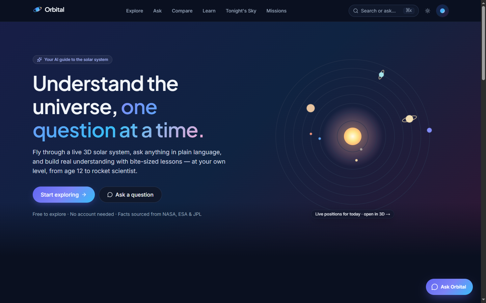
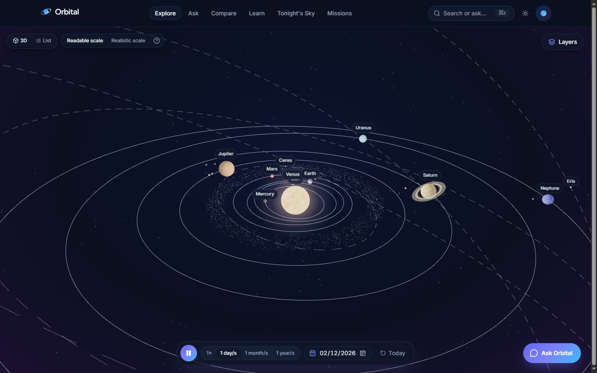
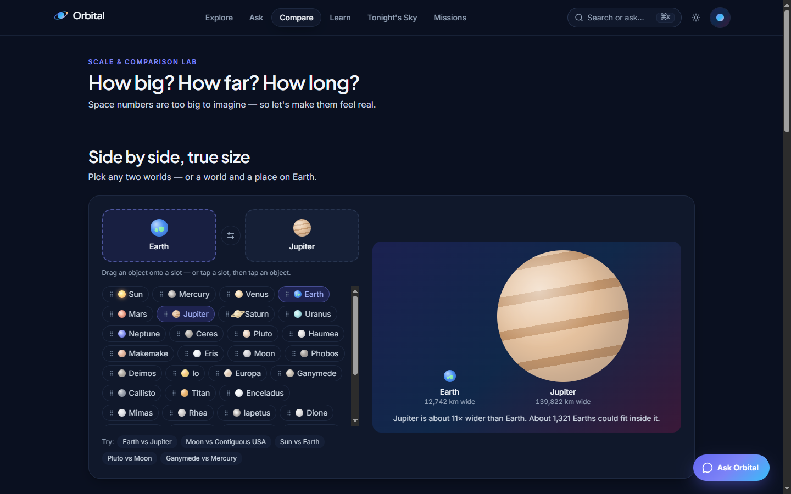
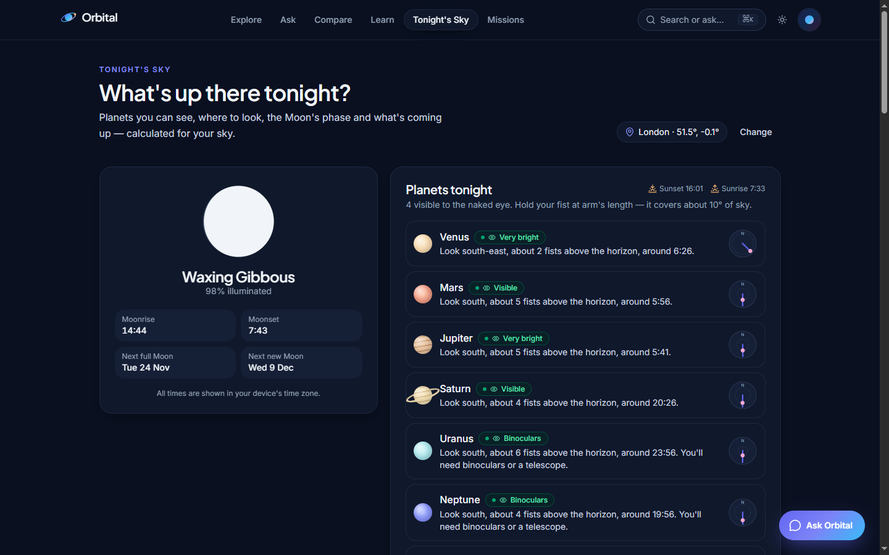
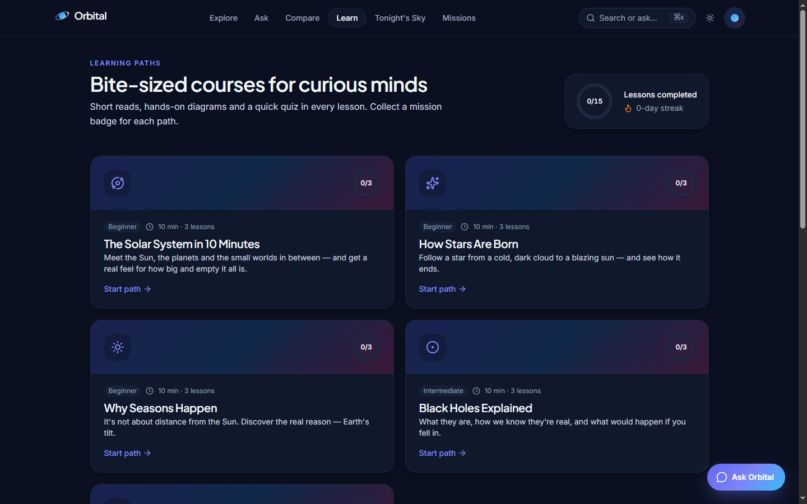
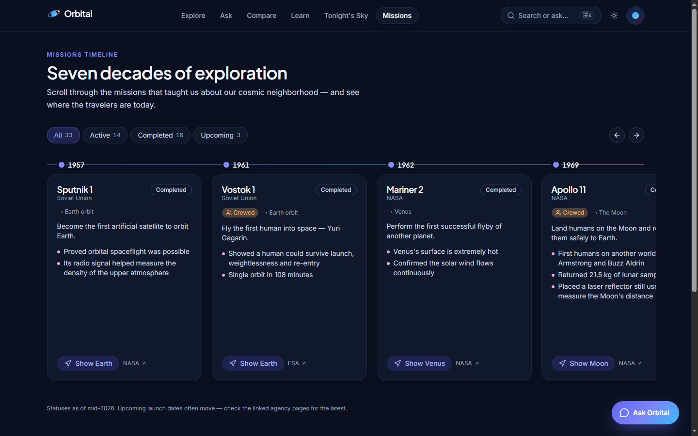
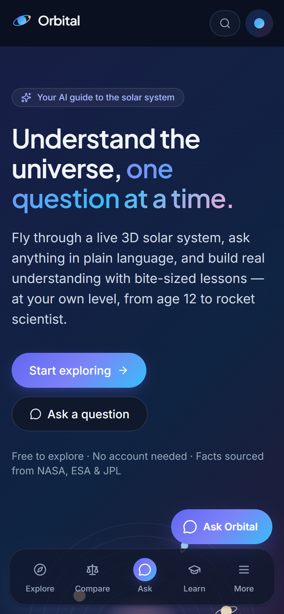
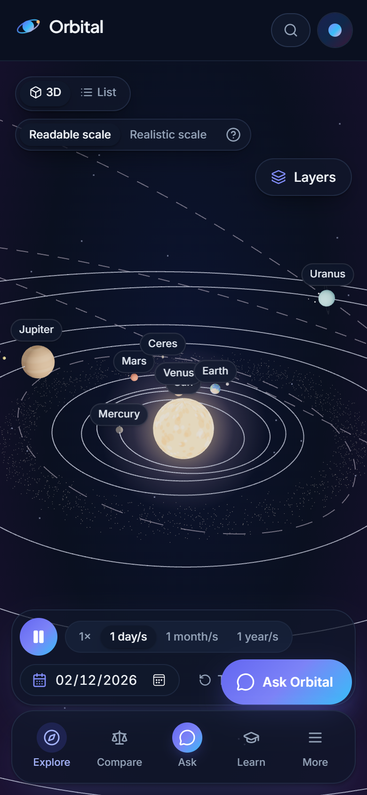

# Orbital

An AI-powered, interactive learning platform for space and our solar system.
Explore a live 3D solar system, ask an AI guide anything, compare worlds to scale,
take bite-sized courses, and see what's in your sky tonight.

**Live site:** https://orbital-livid-ten.vercel.app



## Screenshots

| 3D Explorer | Compare |
|---|---|
|  |  |
| **Tonight's Sky** | **Learn** |
|  |  |
| **Missions** | **Mobile** |
|  |   |

## Quick start

```bash
npm install
cp .env.example .env.local   # add ANTHROPIC_API_KEY to enable the AI guide
npm run dev                  # http://localhost:3000
```

Other scripts: `npm run build`, `npm start`, `npm run typecheck`.

Without an `ANTHROPIC_API_KEY` everything still works: the guide answers from Orbital's
built-in knowledge base (and says so), and personalized quizzes are assembled from lessons.

> **Windows + OneDrive/Documents note:** if Windows Defender *Controlled Folder Access* is on,
> Node can't write inside `Documents`, so `npm install` hangs. Either allow `node.exe` under
> Windows Security → Ransomware protection → *Allow an app*, or build from a folder outside
> `Documents`.

## Features

| Area | Route | Highlights |
|---|---|---|
| Landing | `/` | Gradient hero, live mini solar system (today's real positions), bento features, sample AI answer |
| Explorer | `/explore` | React Three Fiber scene, time controls (pause → 1 yr/s) + date picker, readable/realistic scale with animated explainer, fly-to camera, layers (orbits, labels, belts, moons, spacecraft), info side panel / mobile bottom sheet, accessible list view |
| Ask Orbital | `/ask` + floating button everywhere | Streaming Claude answers, 3 explanation levels, context-aware (knows the focused object), inline visuals via tool calls, follow-up chips, NASA/ESA/JPL sources |
| Compare | `/compare` | Drag-and-drop true-scale comparison (incl. countries), basketball-Sun distance model, travel-time calculator, weight on other worlds |
| Learn | `/learn` | 5 paths × 3 lessons, 10 interactive diagrams, 3-question quizzes, progress rings, streaks, badges, AI-personalized quiz |
| Tonight's Sky | `/sky` | Visible planets with direction + "fists above the horizon", Moon phase, eclipses, oppositions, elongations, meteor showers, ISS passes, `.ics`/Google Calendar export, reminders |
| Missions | `/missions` | 33 missions on a horizontal timeline with status filters and "Where is it now?" links |
| My space | `/dashboard` | Continue learning, recent questions, sky events, fact of the day, NASA APOD, badges, saved worlds, preferences |

Global: ⌘K / Ctrl+K command palette, 3-step skippable onboarding, light/dark/system theme,
reduced-motion mode (OS setting or manual), bottom tab bar on mobile.

## Architecture

```
src/
  app/                 Next.js App Router pages + API routes
    api/chat           Streaming AI guide (NDJSON events)
    api/quiz           Structured-output quiz generation
    api/apod, api/iss  NASA APOD + CelesTrak ISS TLE proxies (cached)
  components/
    ui/                Design-system primitives (Button, Card, Chip, FactCard, ProgressRing, Segmented, …)
    layout/            Navbar, mobile tab bar, footer, command palette, onboarding
    explorer/          3D scene, scale mapping, procedural textures, controls, info panel, list view
    chat/              Chat view, messages + inline visuals, drawer, /ask page
    compare/ learn/ sky/ missions/ dashboard/ landing/ shared/
  data/                Seed content: objects (33), missions (33), learning paths, knowledge notes, extras
  lib/
    types.ts           Shared data models
    store.ts           Zustand stores (prefs + progress persisted to localStorage)
    ephemeris.ts       Planet/dwarf/moon/spacecraft positions
    sky.ts, iss.ts     Tonight's Sky + ISS pass prediction
    ai/                System prompt, tools, retrieval, offline fallback
```

### AI guide

- Model: `claude-opus-5-5` via `@anthropic-ai/sdk`, streamed, effort `medium`, with
  server-side refusal fallbacks (`fallbacks: "default"`).
- The system prompt and tool list are static (prompt-cache friendly). Per-turn context
  — explanation level, focused object, retrieved notes — goes in the user turn.
- Tools render UI rather than fetch data: `focus_on_object` ("Show me" button),
  `show_comparison`, `show_facts`, `suggest_followups`, `cite_sources` (only https links
  on nasa.gov / esa.int / iau.org / … are shown).
- Retrieval: keyword scoring over `src/data/knowledge.ts` + object fact sheets.

### Positions & sky

- Planets and Pluto: `astronomy-engine` (≈1′ accuracy). Ceres, Haumea, Makemake, Eris:
  Keplerian elements. Moons: circular orbits with real periods (illustrative).
- Spacecraft positions are approximate and labelled as such.
- Tonight's Sky runs entirely in the browser; ISS passes use SGP4 (`satellite.js`) with a
  sunlit/dark-sky visibility check.

### Accounts

Progress, badges, chat history and preferences persist in `localStorage`, so there's no
sign-up wall. The account card stores a name/email locally. To add real accounts and cloud
sync, back `usePrefs`/`useProgress` (`src/lib/store.ts`) with Supabase or Clerk + Postgres
and wire the "Continue with Google" button in `components/dashboard/account-card.tsx`.

## Content notes

- Object data is rounded from NASA fact sheets; moon counts are as of 2025.
- Mission statuses are as of mid-2026 — upcoming dates change often.
- The landing page has no testimonials. Add real ones before launch rather than placeholders.
